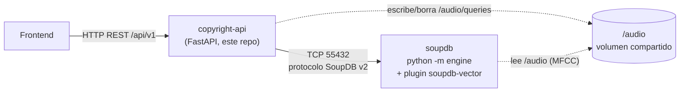

# SoupDB Copyright

Backend de **análisis de similitud de audio** (copyright/remixes): busca posibles
coincidencias entre un audio consultado y las canciones originales de un catálogo.
Devuelve **similitud acústica y evidencia temporal**, no un veredicto jurídico, ni
probabilidades, ni umbral.

Es una aplicación **independiente** de SoupDB: no contiene ni importa código del
gestor. Toda operación de base de datos viaja por TCP con el protocolo público
SoupDB v2.



| Antes (`SoupDB/applications/copyright_detection`) | Ahora (este repo) |
|---|---|
| El API abría `Catalog`, llamaba a `execute_sql` y configuraba `OnDiskVectorFactory` en su proceso | El API solo envía SQL por TCP; SoupDB es otro proceso/contenedor |
| MFCC, codebook y HNSW cargados en el backend | MFCC → TF-IDF → HNSW los ejecuta el plugin `soupdb-vector` dentro de SoupDB |
| Configuración del perfil inyectada por la app al abrir la base | `CREATE EXTENSION HNSW WITH (...)` persistido en `SysPlugins`; SoupDB lo reaplica al arrancar |

## Estructura

```
src/copyright_app/
  config.py, settings.py, schemas.py, errors.py
  domain/            modelos, evidencia temporal (pura) y puertos (interfaces)
  services/          CopyrightAnalyzer, CatalogLibrary, export JSON/CSV
  infrastructure/
    soupdb_client.py cliente TCP del protocolo v2 (framing, codec, pool)
    repositories.py  SoupDBCatalogRepository / SoupDBHistoryRepository / SoupDBSearchRepository
    audio_store.py   volumen /audio compartido (staging de candidatos, audio original)
    segmentation.py  bloques de 5 s del candidato (librosa; sin MFCC)
  api/app.py         FastAPI
  runtime.py         servidor (lifespan: pool TCP, comprobaciones, servicios)
  bootstrap.py       catálogo → manifest → (codebook en SoupDB) → INSERT + HNSW por TCP
data/fma_small_catalog.json   80 canciones FMA Small, 8 géneros, 480 segmentos (sin audio)
docker/soupdb/Dockerfile      imagen del gestor + soupdb-vector (desde el repo SoupDB)
Dockerfile                    imagen del backend (sin código de SoupDB)
tests/unit | integration | e2e
```

## Reglas de desacoplamiento

- Prohibido importar `engine.*`, `soupdb*` o `applications.*` en `src/`. Lo
  comprueba `tests/unit/test_decoupling.py` (AST), que también prohíbe los nombres
  `Catalog`, `execute_sql`, `OnDiskVectorFactory`, `MultimediaProfile`,
  `FileManager`, `TransactionalSession` y `ConnectionHandler`.
- El backend nunca abre archivos de la base ni del índice: solo `/audio`.
- El dominio depende de interfaces (`domain/ports.py`); las implementaciones
  SoupDB usan exclusivamente `SoupDBClient`.

## Cliente TCP (`infrastructure/soupdb_client.py`)

Escrito desde `SoupDB/docs/protocolo.md` (sin copiar `engine.transactions.protocol`):

- Frame: `"SP" | versión 0x02 | opcode | longitud u32 BE | payload`.
- Requests: `PING`, `BEGIN`, `COMMIT`, `ROLLBACK`, `QUERY`, `PREPARE`, `EXECUTE`,
  `DEALLOCATE`. Respuestas: `PONG`, `OK`, `RESULT` (header v2 con `type_name`,
  `encoding`, `size`, `length`), `ERROR` (código + mensaje).
- Valores: `NULL`, `INT` i32, `FLOAT` f64, `TEXT` u16+UTF-8, `BOOL`, `POINT`,
  `BYTES` (tag `0x06`, longitud u32; el documento lo nombra sin dar su valor, se
  verificó contra el servidor real).
- Tipos propios: `QueryResult`, `Column`, `Point`; errores `SoupDBError` (el
  gestor respondió ERROR; la conexión sigue viva), `SoupDBConnectionError`,
  `SoupDBProtocolError`.
- `run(sql, params)` prepara cada sentencia una vez por conexión y la ejecuta con
  `EXECUTE` (`$1..$n` se sustituyen en el AST del servidor, nunca se interpola).
- `SoupDBPool`: una conexión por hilo; descarta las rotas y hace `ROLLBACK` si un
  bloque falla dentro de una transacción.

Todos los datos de usuario (nombre de archivo, ids, metadatos, historial) van como
parámetros. La única excepción es la referencia de `SIMILAR_TO`, que el parser de
SoupDB solo admite como literal (`SIMILAR_TO($1, ...)` da `PARSE: SIMILAR_TO
requires a string reference`): se genera en servidor
(`queries/<uuid4 hex>/candidate.<ext>#segment=NNNNNN`) y se valida con una
expresión regular antes de escribirla.

## SQL remoto

```sql
-- schema (idempotente; existencia y tipos vía SysTables/SysColumns/SysIndexes)
CREATE TABLE songs (song_id INT, title TEXT, artist TEXT, audio_path TEXT, duration_seconds FLOAT)
CREATE TABLE audio_segments (segment_id INT, song_id INT, segment_index INT,
                             start_seconds FLOAT, end_seconds FLOAT, audio_ref TEXT)
CREATE TABLE analyses (analysis_id TEXT, filename TEXT, created_at TEXT,
                       segment_seconds FLOAT, match_count INT)
CREATE TABLE analysis_matches (analysis_id TEXT, match_order INT, song_id INT, query_start FLOAT,
  query_end FLOAT, source_start FLOAT, source_end FLOAT, score FLOAT, segment_count INT,
  min_score FLOAT, max_score FLOAT, alignment_offset_seconds FLOAT, is_best_run BOOL)
CREATE INDEX songs_song_id ON songs (song_id) TYPE BTREE      -- y segment_id, song_id, analysis_id

-- plugin vectorial (bootstrap; persiste en SysPlugins)
CREATE EXTENSION HNSW WITH (storage_root = '/data/plugins/hnsw', profiles = '{"copyright-audio-v1":
  {"kind": "audio_segment", "root": "/audio", "codebook": "/data/artifacts/codebook.npz",
   "cache": "/data/cache"}}')
CREATE INDEX copyright_audio_hnsw ON audio_segments (audio_ref) USING HNSW
  WITH METRIC=euclidean, DIMENSION=128, PROFILE='copyright-audio-v1'

-- búsqueda (una por segmento del candidato; SoupDB vectoriza el segmento)
SELECT segment_id, song_id, segment_index, start_seconds, end_seconds, audio_ref, SCORE() AS score
FROM audio_segments WHERE SIMILAR_TO('queries/<id>/candidate.mp3#segment=000000', k=5)
USING HNSW WITH METRIC=euclidean ORDER BY score DESC

-- todo lo demás con prepared statements, p. ej.
INSERT INTO analysis_matches VALUES ($1, $2, ..., $13)        -- dentro de BEGIN/COMMIT
SELECT * FROM songs WHERE song_id = $1
```

## Volumen compartido `/audio`

```
/audio/fma/000/000002.mp3                      originales (bind de FMA Small, solo lectura)
/audio/queries/<analysis_id>/candidate.mp3     candidatos: los escribe y borra el backend
```

SoupDB y el backend montan la misma `/audio` (raíz del perfil). Las filas guardan
rutas relativas (`fma/000/000002.mp3`, `queries/<id>/candidate.mp3#segment=000000`).
El backend solo escribe bajo `queries/` con un `uuid4` propio; el audio original
se sirve leyendo antes `audio_path` por TCP a partir de un `song_id` y
resolviéndolo bajo `/audio` sin salir de la raíz. La API nunca expone rutas.

## Demo local con Docker

Consulta el [informe de integración](docs/informe-integracion.md) para ver la cobertura REST, la compatibilidad con rsoup y SoupChef, y las pruebas pendientes.

1. Coloca `SoupDB`, `SoupDB-Copyright` y `CevichitoTrujillano` en el mismo directorio y abre una terminal en `SoupDB-Copyright`. Usa Docker Desktop con contenedores Linux o Docker Engine con el plugin Buildx y una versión de Compose que admita `additional_contexts` y `docker compose wait`.
2. Copia `.env.example` a `.env`. Ajusta `FMA_AUDIO_ROOT` a la ruta absoluta de FMA Small extraído, donde están las carpetas `000/`, `001/`, etc. Ajusta `SOUPDB_SOURCE` y `CEVICHITO_SOURCE` si los repositorios están en otras rutas.
3. Valida la configuración, construye las imágenes y prepara el catálogo. En PowerShell, usa `Copy-Item .env.example .env` para crear el archivo del paso anterior.

   ```sh
   docker compose --profile bootstrap --profile demo config --quiet
   docker compose --profile demo build
   docker compose --profile bootstrap up -d bootstrap-catalog
   docker compose --profile bootstrap wait bootstrap-catalog
   docker compose --profile bootstrap logs bootstrap-manifest codebook bootstrap-catalog
   ```

   Espera a que `bootstrap-catalog` termine con código 0. Debe validar las 80 canciones, los 480 segmentos y el índice HNSW. Si falla, revisa los logs de los tres servicios de bootstrap antes de iniciar el frontend.

4. Levanta la API y el frontend, y verifica la salud y el catálogo.

   ```sh
   docker compose --profile demo up -d --wait cevichito
   docker compose --profile demo ps
   curl -f http://127.0.0.1:5173/api/v1/health
   curl -f http://127.0.0.1:5173/api/v1/catalog
   ```

   En Windows usa `curl.exe` si PowerShell asigna `curl` a otro comando. El navegador accede a la API a través del mismo origen del frontend.

5. Abre `http://127.0.0.1:5173`, explora el catálogo y escucha una referencia. Sube una pista FMA del catálogo en **Nuevo análisis**, revisa la evidencia en **Resultados** y confirma que el análisis reaparece en **Historial**. Prueba la descarga de un reporte desde ese resultado.
6. Detén la demo con `docker compose --profile demo --profile bootstrap down`. Los volúmenes conservan el catálogo y el historial para el siguiente arranque.

Para trabajar con Vite desde el host, levanta solo `soupdb` y `copyright-api` después del bootstrap. Ejecuta `npm ci` y `npm run dev` en CevichitoTrujillano, abre `http://localhost:5173` y configura `COPYRIGHT_CORS_ORIGINS` para ese origen. El frontend REST del host usa `http://127.0.0.1:8000` por defecto.

| Servicio | Imagen | Volúmenes | Puerto |
|---|---|---|---|
| `soupdb` | gestor + `soupdb-vector` (`docker/soupdb/Dockerfile`, contexto `SOUPDB_SOURCE`) | `soupdb-data:/data`, FMA → `/audio/fma:ro`, `audio-queries:/audio/queries` | 55432 (host solo `127.0.0.1`) |
| `copyright-api` | `Dockerfile` (sin código de SoupDB) | FMA → `/audio/fma:ro`, `audio-queries:/audio/queries` | 8000 |
| `cevichito` | frontend web REST servido por Nginx, perfil `demo` | | 5173 |
| `bootstrap-manifest`, `codebook`, `bootstrap-catalog` | perfil `bootstrap` | | |

Healthchecks: `soupdb` envía un `PING` v2 y espera `PONG`; `copyright-api` llama a
`/api/v1/health`, que hace `PING` a SoupDB por una conexión nueva y responde 503
si no contesta.

`docker compose stop soupdb` manda `SIGTERM`: el gestor cierra el `Catalog` y
vuelca las páginas (SoupDB no tiene WAL; un `kill -9` puede perder escrituras
recientes). Al reiniciar, SoupDB descubre el plugin, lee `SysPlugins` y reabre el
HNSW sin que el backend intervenga. El backend se puede parar, borrar o
reconstruir sin tocar la base.

### Bootstrap del catálogo FMA

`data/fma_small_catalog.json` describe 80 pistas de FMA Small (las 10 primeras por
`track_id` de cada uno de los 8 `genre_top` que existen y se decodifican), con sus
480 segmentos exactos de 5 s. Se exportó por TCP del catálogo que preparó SoupDB
(`fma_catalog prepare`); el audio (7.2 GiB) no se versiona.

1. `bootstrap-manifest` (backend): valida el JSON, comprueba que cada MP3 existe y
   que su segmentación (librosa, 22 050 Hz mono) coincide, y escribe el manifest
   `audio_segment`.
2. `codebook` (imagen SoupDB): CLI oficial del plugin
   `python -m soupdb_vector.multimedia.build_vectors manifest /audio /data/cache
   /data/artifacts/codebook.npz /tmp/vectores.bin --k 128 --seed 0`
   (K-Means K=128 sobre MFCC de 20 coeficientes, `max_descriptors=50000`, IDF). No
   sobrescribe un codebook existente e imprime su SHA-256. Corpus: los 480
   segmentos del catálogo. Artefacto desplegado y verificado (imagen
   `python:3.12-slim`, `uv.lock` de SoupDB):
   `ed27c127b02ea5a022b7bd256f5c440cbba55fa49124d2d3e22502c44d084d37`. No es
   idéntico bit a bit al codebook que SoupDB entrenó antes en Windows (otra
   plataforma y otra decodificación MP3); por eso se registra el SHA de cada despliegue.
3. `bootstrap-catalog` (backend, TCP): tablas, 80 canciones y 480 segmentos con
   invariantes (en transacciones), `CREATE EXTENSION HNSW`, `CREATE INDEX` y
   verificación de conteos (`SysPluginIndexes.item_count = 480`). Es idempotente.

El backend en ejecución no entrena codebooks ni crea índices.

## API

| Método | Ruta | |
|---|---|---|
| `GET` | `/api/v1/health` | 200 si SoupDB responde a `PING`, si no 503 |
| `POST` | `/api/v1/analyze` | multipart `file`; guarda el análisis en el historial |
| `GET` | `/api/v1/catalog`, `/api/v1/catalog/{song_id}` | catálogo de solo lectura |
| `GET` | `/api/v1/catalog/{song_id}/audio` | audio original (admite `Range`) |
| `GET` | `/api/v1/analyses`, `/api/v1/analyses/{id}` | historial |
| `GET` | `/api/v1/analyses/{id}/export?format=json\|csv` | export |

Errores: 422 audio inválido, 503 SoupDB o índice no disponible, 500 genérico.

## Configuración

`SOUPDB_HOST` (`soupdb`), `SOUPDB_PORT` (`55432`), `SOUPDB_TIMEOUT_SECONDS` (60),
`SOUPDB_POOL_SIZE` (4), `COPYRIGHT_AUDIO_ROOT` (`/audio`), `COPYRIGHT_SEARCH_K` (5),
`COPYRIGHT_MAX_UPLOAD_MB` (50), `COPYRIGHT_HOST`, `COPYRIGHT_PORT`,
`COPYRIGHT_CORS_ORIGINS`.

## Tests

```bash
uv sync
uv run pytest tests/unit                 # sin SoupDB
uv run pytest tests/integration tests/e2e  # servidor SoupDB real como proceso externo
```

Los tests de integración y E2E arrancan `python -m engine` con el intérprete de un
entorno SoupDB (`SOUPDB_PYTHON`; busca `../SoupDB/.venv`) y hablan con él
solo por TCP; no importan el gestor. El E2E FMA necesita `FMA_AUDIO_ROOT`. Si falta
alguno, esos tests se marcan como *skip* con el motivo.

## Limitaciones

- Sin umbral calibrado; `score` (`1 / (1 + d)`) es similitud, no probabilidad.
- La referencia de `SIMILAR_TO` va como literal (el parser no admite parámetro ahí).
- SoupDB no tiene WAL: la durabilidad depende de un apagado ordenado.
- La caché MFCC de SoupDB guarda entradas de candidatos ya borrados (sin limpieza).
- Con el HNSW creado, añadir canciones exige reconstruir el índice (no hay endpoint).
- Resolución temporal de 5 s (segmentos sin solapamiento).
- Ambos contenedores corren como root para compartir `audio-queries`.
